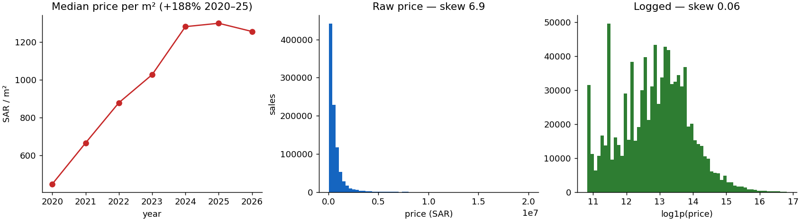

# Saudi House Price Prediction

Predicting residential property transaction prices in Saudi Arabia from Ministry of
Justice open data, 2020–2026. 1.27 million transactions, cleaned to 1.22 million,
modelled on 928 thousand.

**Headline result:** a gradient-boosted model reaches **R² 0.661** (log space) on a
time-ordered test set of 2025–2026 sales, against a non-ML baseline of **0.536** — and
removes a systematic 19% under-prediction. Validated the lazy way with a shuffled
KFold, the same model would have scored **0.727**, a number it cannot deliver on
future sales.

---

## The problem

Given the location, size and date of a residential property transaction, predict its
price. The intended use is a sanity check on a declared price — flagging transactions
that sit far from what comparable recent sales suggest — not an automated valuation.
That framing matters: a 28% typical error is useless for pricing a single home and
perfectly adequate for flagging a 10x outlier.

## The data

- **Source:** Saudi Ministry of Justice real estate sale transactions, published as
  open data and mirrored at
  [civillizard/Saudi-Real-Estate-Data](https://github.com/civillizard/Saudi-Real-Estate-Data).
- **Licence:** KSA Open Data License. Attribution required; the raw files are
  redistributed unmodified.
- **Size:** 1,269,512 transactions across 23 quarterly files, 2020-01-01 to 2026-03-31.
- **Not included in this repository.** Run `python build_dataset.py` to download and
  rebuild it (~162 MB of CSV, ~18 MB as parquet).

Column dictionary: [`SCHEMA.md`](SCHEMA.md).

Three quarters are absent from the data: **2020-Q4, 2021-Q1 and 2025-Q2**. The first
two have no file at all. The third is more interesting — see below.

## Cleaning decisions

Full log: [`docs/cleaning_decisions.csv`](docs/cleaning_decisions.csv). Notebook:
[`notebooks/02-clean.ipynb`](notebooks/02-clean.ipynb). The five that mattered:

**A mislabelled file.** `MOJ-Sales-2025-Q2.csv` contains transactions dated April–June
**2024**, not 2025. 47,211 of its 47,518 transaction references already appear in the
2024-Q2 file — it is that quarter republished. Found by comparing each file's date
range against its name:

```python
df.groupby("quarter").date_greg.agg(["min", "max", "count"])
```

Rather than deleting the file, `quarter` is now derived from `date_greg`, so a
mislabelled filename cannot corrupt a time-based split. This is a generic fix: it
keeps working if the ministry mislabels a different file next quarter.

**47,211 duplicate transactions, from that one file.** Deduplication is on `deal_ref`,
not on whole rows. Whole-row deduplication finds nothing, because the loader adds
`source_file` and `quarter` columns that differ between the copies. Deduplicating on
the transaction reference also keeps the 307 rows in the republished file that are
genuinely new. Verified safe: every repeated reference in all 1.27 million rows
involves that file, with no legitimate repeats anywhere else.

**District names are not unique across cities.** 1,241 district names appear in more
than one city, affecting **770,395 rows — 63% of the data**. العزيزية exists in both
Riyadh and Jeddah and they are different places with different prices. Location is
therefore modelled as a combined `city/district` key: 17,310 distinct values.

**`أخرى` ("other") is 10.1% of rows**, 123,576 transactions across 165 cities. It is a
placeholder for an unrecorded district, not a neighbourhood. It is kept *inside* the
combined key rather than set to null, because the city is still known — "الرياض/أخرى"
means "unspecified district in Riyadh", which is real information.

**Extreme values kept, not deleted.** Prices run to 31.8 billion SAR and areas to 24
million m². These are not errors: 1,558 of the 1,693 rows above a million square metres
are agricultural land, and 447 of the 635 above 100 million SAR are commercial. They
are a different market, excluded by the scope filter below rather than destroyed during
cleaning — so "how does this do on farmland?" remains an answerable question.

Also: 16 region spellings normalised to the 13 real regions; a `حي ` prefix stripped
from 163 duplicate district spellings; one row with `area_m2 = 0` dropped; 12 blank
rows dropped; `price_per_m2`, `plan` and `parcel_no` columns dropped.

**1,269,512 → 1,222,288 rows (3.7% removed), 17 → 15 columns.**

Cleaning fixes what is *wrong*. Choosing which population to model is a separate
decision, stated below, so it can be changed without rebuilding.

## Scope

```python
df.classification == "سكني"             # residential only
and not df.is_multi_property            # one property per deal
and 50 <= df.area_m2 <= 5_000
and 50_000 <= df.price_sar <= 20_000_000
```

**927,761 rows, 75.9% of the cleaned data.** Commercial and agricultural land price on
completely different logic. Multi-property deals report a combined price, so
price-per-property is undefined for them. The area and price bands exclude things that
are not dwellings in any ordinary sense.

## Exploratory findings



**The market rose 188% and then stopped.** Median price per square metre, residential:

| 2020 | 2021 | 2022 | 2023 | 2024 | 2025 | 2026 |
|---|---|---|---|---|---|---|
| 450 | 667 | 879 | 1,027 | 1,280 | 1,298 | 1,255 |

This single table determines the validation strategy, and it is the reason time is a
model feature rather than an afterthought.

**The target needs a log transform.** Price skew is 6.91; `log1p(price)` brings it to
**0.06**. All models predict `log1p(price_sar)` and all R² and MAE figures below are in
log space.

**Locations are extremely sparse.** Of 17,310 city/district pairs, the median holds 3
transactions, the 25th percentile holds 1, and 11,667 have fewer than 10. This rules
out one-hot encoding and naive target encoding, and dictates the encoder choice below.

**Prices are declared, not measured.** There is a hard reporting floor at 5,000 SAR
with 12,449 rows sitting exactly on it and nothing below, and heavy clustering on round
numbers — 100,000, 200,000, 50,000, 300,000. Visible as combs in the logged histogram.

## Baseline

Stated before any model was built: **median price per m² for the location × the area**.
Fitted on training rows only, requiring at least 10 sales per location, falling back to
the city median and then the global median. 6.0% of test rows fell back.

| metric | value |
|---|---|
| R² (log) | 0.5363 |
| MAE (log) | 0.4893 |
| median absolute % error | 31.1% |
| bias (median predicted/actual) | **0.808** |

That bias is the baseline's real failure: it under-predicts every test row by about
19%, because it pools six years of rising prices into one median while the test period
sits above all of them.

## Model

[`notebooks/05-model.ipynb`](notebooks/05-model.ipynb). A single sklearn `Pipeline`
containing every fitted step:

```
ColumnTransformer
├── passthrough : log_area, t
└── TargetEncoder : location, city, region
        ↓
HistGradientBoostingRegressor(max_iter=400, learning_rate=0.1, min_samples_leaf=50)
```

`TargetEncoder` is the answer to the sparsity problem. One-hot would produce 17,310
mostly-empty columns; ordinal encoding would invent an order that does not exist; a
hand-rolled category mean leaks, because a location's mean includes the row being
predicted. `TargetEncoder` cross-fits internally, and because it lives inside the
Pipeline it refits on every fold and never sees held-out data.

Features: `log_area` (area skew is 4.57; logging linearises the relationship with
log-price), `t` (continuous years since 2020-01-01), and the three location columns.

## Validation

**Split on time at 2025-01-01.** Train 773,674 rows (2020–2024), test 154,087 rows
(2025 through Q1 2026). The trend table above is the justification: under a shuffled
split, a model predicting a 2021 sale would have been trained on 2025 sales.

| model | R² | MAE | median % error | bias |
|---|---|---|---|---|
| Baseline (location median × area) | 0.536 | 0.489 | 31.1% | 0.808 |
| Ridge | 0.595 | 0.469 | 34.5% | 1.076 |
| **HistGradientBoosting** | **0.661** | **0.412** | **27.6%** | **0.988** |

Three things worth reading out of that table.

The gradient booster beats the baseline by 0.125 R² and, more importantly, **removes
the systematic bias** — 0.808 to 0.988. A model that is wrong in the same direction on
every row is worse than one that is merely imprecise.

Linear reaches 0.595 of the eventual 0.661, so non-linearity is worth 0.067. The
sophisticated model is an improvement, not a transformation.

The three methods fail in three different directions, each explained by what they do.
The baseline pools six years and under-shoots. Ridge fits a straight line through the
time trend and extrapolates it past the 2024 plateau, over-shooting by 7.6%. The tree
cannot extrapolate beyond its training range, which here is the correct behaviour.

### What the lazy validation would have said

| validation | R² |
|---|---|
| Shuffled 5-fold KFold | 0.7273 |
| **Time-ordered split (used here)** | **0.661** |
| gap | **0.066** |

Validated with a shuffled KFold, this model reports a score 10% higher than it can
deliver on future sales. Nothing crashes and no warning appears.

## Leakage check

Single-feature R², depth-3 tree, 3-fold, training data only:

| feature | R² |
|---|---|
| location (target-encoded) | 0.560 |
| city (target-encoded) | 0.382 |
| region (target-encoded) | 0.141 |
| log_area | 0.059 |
| t | 0.036 |

Nothing suspicious. Location being the strongest single predictor is the expected and
honest result for housing.

**The dataset ships a leak.** The 2023-Q1 files contain a `سعر المتر المربع`
(price per m²) column, which is `price_sar / area_m2` — a direct function of the
target. It is dropped during cleaning. Restoring it:

| model | R² |
|---|---|
| clean | 0.661 |
| with `price_per_m2` | **0.9989** |

Near-perfect prediction, no error, no warning, and entirely worthless.

## What this model cannot do

**It does not know what the building is like.** The ministry records location, area,
classification and date. It does not record floor, age, condition, finish quality,
view, or whether the property has been renovated. Within a single location in a single
year, the interquartile range of price per square metre is **49% of the median** — that
spread is the irreducible error, and no amount of modelling removes it.

**It cannot extrapolate the market.** The tree's predictions are bounded by its
training range, so a sustained move above 2024 price levels would not be followed. The
Ridge comparison shows the alternative failure: extrapolate the trend and over-shoot by
7.6% once the market flattens.

**It has nothing to say about three quarters.** 2020-Q4, 2021-Q1 and 2025-Q2 are absent
from the source data.

**Prices are declared, not appraised.** The 5,000 SAR floor censors cheap transactions
and the round-number clustering caps achievable precision.

**It is scoped to residential single-property sales** in the stated size and price
bands — 76% of cleaned transactions. It says nothing about commercial or agricultural
land.

A typical prediction is off by about 28%. That is enough to flag a transaction priced
at several times its neighbours. It is not enough to value a house.

## Reproducing this

```bash
git clone https://github.com/hsnwebdev/ksa-house-prices.git
cd ksa-house-prices
```

**conda**

```bash
conda env create -f environment.yml
conda activate ksa-house
```

**pip / venv**

```bash
python -m venv .venv && source .venv/bin/activate
pip install -r requirements.txt
```

Then:

```bash
python build_dataset.py        # downloads 23 quarterly CSVs, writes the parquet
jupyter lab notebooks/
```

Run the notebooks in order: `01-profile` → `02-clean` → `03-eda` → `04-baseline` →
`05-model`.

Figures in this README were produced on scikit-learn 1.7.2. `TargetEncoder` internals
changed in later versions and move the third decimal place.

## Repository layout

```
build_dataset.py              download and assemble the raw data
SCHEMA.md                     column dictionary, Arabic → English
docs/cleaning_decisions.csv   the nine cleaning decisions and their reasoning
docs/eda_overview.png         market trend and target distribution
notebooks/01-profile.ipynb    profiling: what is in the data and what is wrong with it
notebooks/02-clean.ipynb      the nine decisions, applied
notebooks/03-eda.ipynb        scope, market trend, target transform
notebooks/04-baseline.ipynb   the non-ML number to beat
notebooks/05-model.ipynb      Pipeline, model comparison, validation, leakage check
```

## Notes on this repository

`build_dataset.py` and the first draft of `SCHEMA.md` were written with AI assistance;
everything in the notebooks is my own work, and I can account for every line of the
loader. The mislabelled-file finding, the duplicate diagnosis and the district
ambiguity were found by inspection of this dataset, not taken from any existing
write-up of it.

Data © Ministry of Justice, Kingdom of Saudi Arabia, under the KSA Open Data License.
